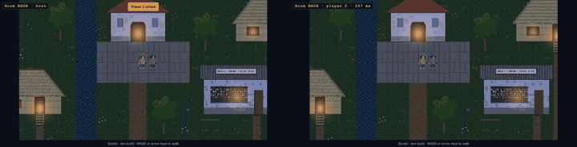

# Sundo

[](https://github.com/ElleDiablo/sundo/actions/workflows/ci.yml)

> During a brownout in a rural Philippine barangay, five children are lost in the dark.
> Work together to bring them home before dawn, while a **tikbalang that learns from every game
> ever played** waits on the paths you always take.

A co-op multiplayer pixel horror game in the browser, built on AWS serverless, with a data lake
that teaches the monster. Humans, classic AI bots and LLM players share the same world.

**Status:** Sprint 1 done: walk together (v0.2.0) · **Live (dev):** [d2k0lzzbi69b8k.cloudfront.net](https://d2k0lzzbi69b8k.cloudfront.net)



*Two browsers in one room through the AWS relay: the host (left) runs the game, the guest (right)
sends keys and draws the host's snapshots 20 times a second.*

**Try it:** open the live link, press **Create room**, and share the 4-letter code. Friends open
the same link, press **Join with code** and type it. Walk with WASD or the arrow keys, pick a hat
and a shirt in the kapilya plaza, and the host presses **Start round**. Find the lost children and
press **E** next to one so they follow you (up to two at a time).

## Highlights
- **Real-time multiplayer, fully serverless:** API Gateway WebSockets + Lambda + DynamoDB, with
  the host's browser running the simulation (no game servers billed by the hour).
- **Big Data loop:** every game event lands in an S3 data lake (raw JSON → curated Parquet,
  compacted nightly); Athena turns the history into the tikbalang's nightly "knowledge map".
- **Humans vs bots vs LLMs:** one deterministic engine runs in the browser, in tests and in a
  simulator that plays thousands of rounds with A* bots and LLM players.
- **Engineered like production:** infrastructure as code (AWS CDK), architecture decision records,
  CI on every pull request, keyless deploys with GitHub OIDC, budgets and least-privilege IAM.

## Architecture
See [docs/02-architecture.md](docs/02-architecture.md) for diagrams, the data model, security
and cost, and [docs/adr/](docs/adr/) for why each choice was made.

| Layer | AWS services |
|---|---|
| Web | S3 (private) + CloudFront (origin access control) |
| Real-time | API Gateway WebSocket, Lambda, DynamoDB (TTL) |
| Data lake | S3 raw → curated (Parquet), Glue Data Catalog, Athena |
| Learning | EventBridge schedule → Python Lambda → Athena → `knowledge/latest.json` |
| Ops | CloudWatch alarms and dashboard, AWS Budgets |

## Repo layout
```
packages/engine   deterministic game engine (TypeScript, no I/O)
packages/client   the game in the browser: Phaser 4 + Vite, lobby, networking, interpolation
packages/server   the WebSocket relay Lambda: rooms, seats, inputs and snapshots
infra/            AWS CDK app (TypeScript)
docs/             game design, architecture, ADRs
```
More packages (`sim`, `learner`) are added as the sprints reach them.

## Run it locally
Requires Node 26 (see `.nvmrc`).
```
npm ci
npm run lint && npm run typecheck && npm test
npm run synth -w infra     # build the CloudFormation templates (no AWS account needed)
npm run dev -w @sundo/client   # the game at http://localhost:5173 (single player without a relay)
```
Multiplayer locally needs a deployed relay: `npm run config -w @sundo/client` writes its address
to `packages/client/public/config.local.json` (git-ignored).

## Docs
| Doc | What's in it |
|---|---|
| [Game design](docs/01-game-design.md) | Rules, characters, map, the learning loop |
| [Architecture](docs/02-architecture.md) | AWS design, data model, security, cost |
| [Decisions (ADRs)](docs/adr/) | Why it's built this way |

## Author
Built by **Judelle Gaza** ([@ElleDiablo](https://github.com/ElleDiablo)).
