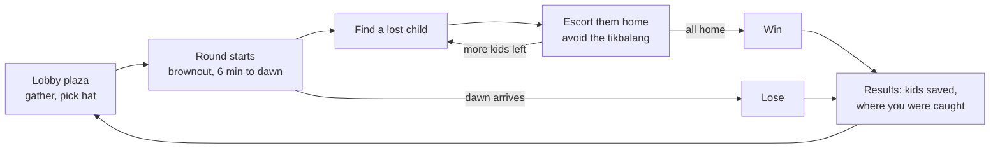

# Sundo: Game Design Document (GDD)

**Status:** v0.2 draft · **Owner:** Judelle Gaza · **Last updated:** 2026-11-25

> **Sundo** (Tagalog: *to fetch, to pick someone up*). During a brownout in a rural barangay,
> five children are lost in the dark. Work together to bring them home before dawn, while a
> tikbalang that has **studied every game ever played** waits on the paths you always take.

---

## 1. Pillars
Every feature must support at least one pillar. If it supports none, it's cut.

1. **Together in the dark.** Co-op, not betrayal. Players win or lose as a team.
2. **Filipino folklore, played straight.** Real beliefs become mechanics (the inside-out shirt).
3. **The monster learns.** Every round makes the tikbalang smarter, and players can *see* that.
4. **Humans, bots and AIs share one world.** Any seat can be a person, a classic bot or an LLM.

## 2. Target players and platform
- Friends and classmates on laptops, 10-minute sessions, joined by room code.
- Desktop browser only (keyboard). Mobile is out of scope for v1.
- PG-13 tone: spooky, not gory. Getting caught means getting *lost*, never dying.

## 3. Core loop

**Win:** all 5 children are home before dawn. **Lose:** dawn arrives first.
**Score:** children saved × 100 + seconds left × 2 − times lost × 25 (shared team score).

## 4. Setting and map

**Barangay Malayo**, a fictional rice-farming barangay. The power is out and it's raining.
One map, about 48 × 32 tiles of 16 px, viewed from above.

| Zone | Feel | Gameplay purpose |
|---|---|---|
| **Kapilya plaza** | Candles, the only safe light | Spawn and lobby; the tikbalang can't enter |
| **Sari-sari store** | Generator hum, one bulb | Small safe zone; battery pickups |
| **Rice paddies** | Open, wide, moonlit | Walkable only along the narrow dikes: a maze that can be seen across but not cut through; easy to be spotted on |
| **Bamboo grove** | Dense, dark, creaking | Short-cut, but the tikbalang's home |
| **Creek and bridge** | Narrow, loud water | Choke point; perfect ambush spot |
| **Five houses** | Each with a lit doorway | Each child's home (destination) |

A good map has **two or three routes** to each house so players make choices, and those
choices are what the tikbalang learns from.

**Paddy dikes.** The paddies are water; only the raised dikes between them (1 tile wide) can be
walked on. Dikes meet at junctions, so crossing the paddies means picking a line through a small
grid. Two players can't pass each other on a dike, and a tikbalang at a junction blocks it.

**Dogs.** Three or four dogs (*aso*) sleep at fixed spots: by houses, the store and the bridge.
When the tikbalang passes within 5 tiles of one, it wakes and barks for 3 s, then sleeps again.
Barking is heard across the map, from the dog's direction, and shown as a small ring at the
screen edge for players with sound off. Dogs are a second warning besides the hoofbeats, and a
clue about where the tikbalang is. The tikbalang doesn't hurt them.

## 5. Characters

### Players: *the tanod* (night watch volunteers)
| Action | Key | Detail |
|---|---|---|
| Move | WASD / arrows | 4 tiles/s; 2.5 tiles/s while escorting |
| Flashlight | Space / left mouse | Cone of light, aimed with the mouse (or the way you walk); battery lasts 90 s total, recharges in safe zones |
| Call a child | E | A nearby lost child starts following you |
| **Baliktad** | Q | Turn your shirt inside out: the tikbalang can't see you for 5 s. 30 s cooldown |
| Emote | 1–4 | "Dito!" (here), "Takbo!" (run), "Tulong!" (help), "Salamat!" (thanks) |

Players can't type chat in v1. Emotes are faster, work for bots too and need no moderation
(see ADR-0005).

### The lost children (*batang ligaw*)
- 5 per round, placed at random spots chosen from 12 possible spots.
- Follow one player in a trailing line. A player can lead up to 2 children.
- If their escort is caught, they scatter to the nearest hiding spot and must be found again.
- Left alone for 20 s near the tikbalang, they cry, which reveals their location to everyone.

### The tikbalang (AI monster, not a player)
A tall, half-horse spirit known for leading travellers astray.
- Normal speed: slightly faster than a player who is escorting (3 tiles/s), slower than one who isn't (4 tiles/s).
- **Chase burst:** when it starts a Chase, it sprints at **5 tiles/s for 2 s**, then must rest
  (walk at 2 tiles/s) for 3 s before it can burst again. No player can simply outrun it: the way
  out is breaking line of sight, lighting it up, reaching a safe zone or using baliktad. The rest
  after a burst is the window to escape.
- Can't enter lit safe zones. Is slowed by flashlight light shone directly at it.
- **Catching a player** makes them *naligaw* (lost): they're dropped somewhere random in the
  bamboo grove, and any children following them scatter.
- Can't see a player who is in *baliktad*.

**Behaviour states** (a state machine; see architecture doc):

| State | What it does | Switches when |
|---|---|---|
| **Patrol** | Walks between points on its knowledge map | Sees a player → Stalk |
| **Ambush** | Waits hidden at a learned hot spot | Player comes within 4 tiles → Chase |
| **Stalk** | Follows at a distance, out of the flashlight | Player is alone or slow → Chase |
| **Chase** | Bursts at the player (5 tiles/s for 2 s), then rests 3 s, then runs at normal speed | Catch → Patrol; lost sight for 3 s → Patrol |
| **Lured** | Follows a crying child | Child is rescued → Patrol |

## 6. The learning loop (pillar 3)

Every night, the data pipeline reads all rounds from the past 7 days and builds the
tikbalang's **knowledge map** (*kaalaman*):

1. **Path heat:** where players walk most often.
2. **Hiding heat:** where players stand still or use baliktad.
3. **Catch heat:** where catches succeeded.

The tikbalang chooses ambush points from these maps, weighted by heat. So if everyone uses the
bridge, the bridge gets dangerous, and players have to change their routes. It's a slow
cat-and-mouse game between the community and the monster.

**Players can see it learning:**
- The title screen shows *"Night 14 · The tikbalang has watched 12,431 rounds."*
- The results screen shows a heatmap of where your team was caught versus everyone else.
- A public **Stats page** shows the knowledge map changing over time.

**Balance guard:** if the human win rate over the past 7 days drops below 35%, the tikbalang
spends less time ambushing; above 65%, more. **Target: 40–60% human win rate.**

## 7. Who can fill a seat (pillar 4)

| Seat type | Where it plays | How it decides |
|---|---|---|
| **Human** | Browser | Keyboard |
| **Classic bot: "Bagito"** (rookie) | Browser (fills empty seats) or simulator | Picks the nearest child, walks the shortest path (A*) |
| **Classic bot: "Beterano"** (veteran) | Browser or simulator | A* that avoids tiles where the tikbalang was recently seen; uses baliktad when chased |
| **Classic bot: "Q-learner"** *(stretch)* | Simulator only | Tabular Q-learning trained on simulated rounds |
| **LLM player** | Simulator only (v1) | Gets a text description of the map every 2 s of game time and picks a goal; A* walks there |

LLM players are slow (1–3 s per answer), so in the simulator **game time pauses while they
think**. That keeps the comparison fair: we measure decisions, not network speed.

**AI Tournament mode** (stretch): teams made of one kind of seat play 100 rounds each. The
leaderboard compares win rates: humans, Bagito, Beterano, Q-learner, Gemini, Llama, Claude, and so on.

## 8. Lobby (the social hangout)
- The kapilya plaza is the lobby. Players walk around, emote and pick a hat (salakot, cap,
  bandana, none) and a shirt colour.
- The host presses **Start** when everyone is ready, or a 10 s countdown starts once 4 seats are full.
- Empty seats can be filled with bots (host's choice).
- Room codes are 4 letters, like `BAHO`, filtered for rude words.

## 9. Look and sound
- **Art:** 16 × 16 pixel art, limited palette (deep blues and greens; warm yellow for safe light).
  Tiles and buildings are generated by a script in the art direction prototype's style
  (`packages/client/scripts/make-assets.ts`); characters come from my own character sheet.
  Hand-drawn tiles can replace the generated ones later without changing the map.
- **Lighting:** the whole map is dark, except flashlight cones, safe zones, doorways and lightning flashes.
  Coloured lights tint the art but are capped, so they never wash it out (the "lit pixel art" look).
- **Procedural decoration:** the map layout is hand-made (the learning loop needs a fixed map),
  but grass tufts, flowers, pebbles, fallen leaves and puddles are scattered by seeded rules:
  never on paths, water or buildings; flowers in clusters; tufts thicker along edges; leaves under
  trees. The round's seed decides the scatter, so replays look identical.
- **Layering:** tall things (roofs, walls, fences, bamboo, trees) are sorted by the ground line
  they stand on, so characters walk behind them, never over or through them.
- **Sound (CC0 sources):** rain, crickets, the creek, the generator hum, distant hooves, barking dogs.
  Hooves get louder as the tikbalang gets closer, which is the main horror tool.
- **Accessibility:** no rapid strobing (lightning is a soft fade); hooves also shown as an
  on-screen ring for players with sound off; colour-blind-safe player colours.

## 10. Scope

| In v1 (MVP) | Later | Never (v1) |
|---|---|---|
| One map, 1–4 seats, room codes | Second map (fiesta night) | Accounts and passwords |
| Children, escort, baliktad, flashlight | Host migration if host leaves | Text chat |
| Tikbalang state machine + knowledge map | Q-learner bot | Mobile / touch |
| Bagito + Beterano bots | Live LLM players in human rooms | Payments, ads |
| Telemetry, data lake, nightly learning, Stats page | Seasonal leaderboard | Copying any existing game's art, names or levels |
| LLM players in the simulator | Custom hand-drawn hats | |

## 11. Success measures
- **Fun:** human playtesters choose to play a second round (target 70%+ of sessions).
- **Balance:** human win rate 40–60% after the learning loop is on.
- **Learning is real:** win rate for players who always take the same route drops over a week.
- **Data scale:** 1,000,000+ events in the data lake (simulator included) by the end of Sprint 5.

## 12. Open questions
- [ ] Is 6 minutes the right round length? (Playtest in Sprint 3.)
- [ ] Should a caught player keep their flashlight battery? (Playtest.)
- [ ] Should the tikbalang get a name or a voice line? Cultural check with family or friends.
- [ ] Which free LLM tiers are actually usable at tournament scale? (Spike in Sprint 7.)
