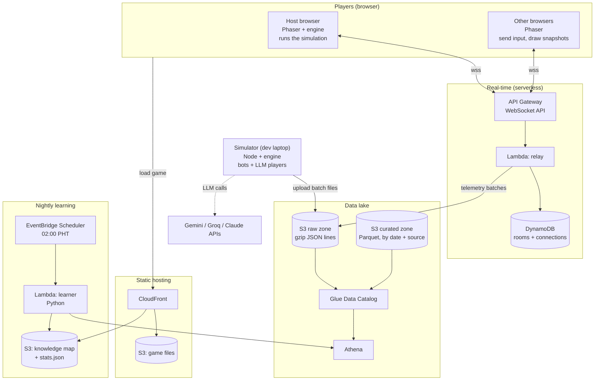
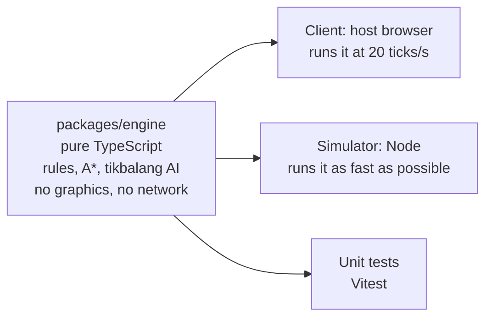
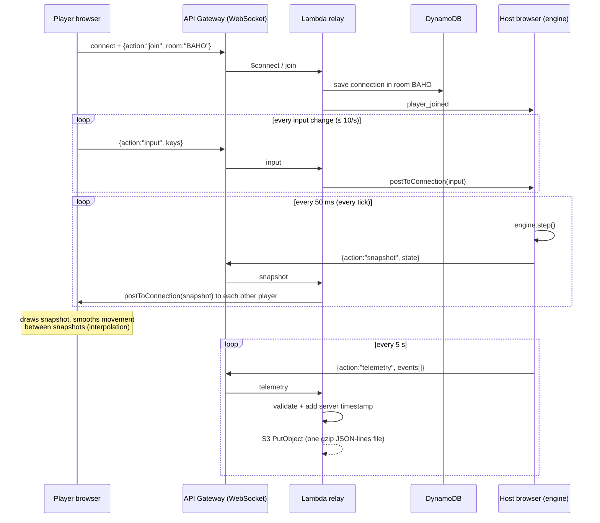
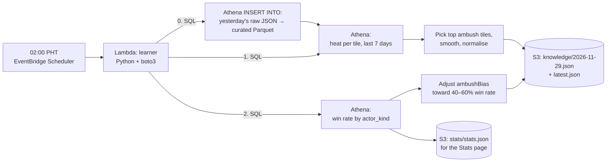
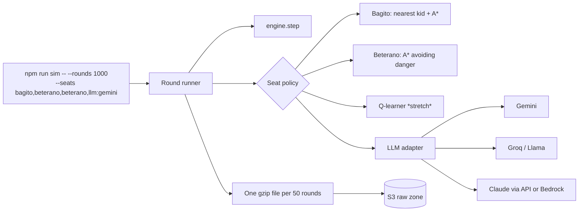
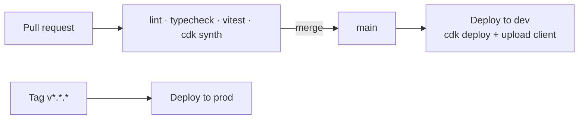

# Sundo: Architecture

**Status:** v0.1 draft · **Last updated:** 2026-11-25 · **Decisions:** see [`adr/`](adr/)

---

## 1. Goals and limits

| Goal | Concretely |
|---|---|
| Real-time co-op for 1–4 seats | Player movement visible to others within ~150 ms in the same region |
| Cost about $0 | Stay in AWS free tier / credits; no service that charges by the hour while idle |
| Real Big Data | Millions of events, columnar storage, SQL over a data lake |
| The monster learns | A nightly job turns history into the tikbalang's knowledge map |
| Professional delivery | Infrastructure as code, CI/CD, least-privilege IAM, alarms |

**Explicit limits:** friends-and-classmates scale (dozens of rooms, not thousands). Cheating
isn't a concern in a co-op game with no rewards (see ADR-0001 for when that would change).

---

## 2. System overview



### The five parts

| Part | Job | AWS services |
|---|---|---|
| **Static hosting** | Serve the game (HTML/JS/art) and the public stats JSON | S3, CloudFront |
| **Real-time relay** | Rooms, joining, passing messages between browsers | API Gateway WebSocket, Lambda, DynamoDB |
| **Data lake** | Store every game event cheaply; query with SQL | S3 (raw + curated zones), Glue Data Catalog, Athena |
| **Nightly learning** | Compact raw → Parquet, then build the knowledge map and stats | EventBridge Scheduler, Lambda (Python), Athena |
| **Simulator** | Play thousands of bot/LLM rounds to generate data | Runs locally; uploads batch files to S3 |

---

## 3. Key idea: one game engine, three places



The engine is **deterministic**: same starting seed + same inputs = same result, every time.
- **Fixed time step:** 20 ticks per second (50 ms each), regardless of frame rate.
- **Seeded random numbers:** no `Math.random()` inside the engine.
- **Pure functions:** `step(state, inputs) → { state, events }`. No DOM, no `fetch`, no clock.
- **Whole-number positions (fixed-point):** 1 tile = 1000 units. A player moves 200 units per
  tick (4 tiles/s), or 141 per axis diagonally. Integer maths has no float rounding, so wall
  collision is exact. The client divides by 1000 only when drawing.
- **Collision:** each player is a 0.6 × 0.6-tile box. Movement is applied one axis at a time
  (x, then y), so a blocked diagonal slides along the wall. Outside the map counts as wall.

**Why this matters:**
1. Bots in the simulator play by *exactly* the same rules as people in the browser.
2. Tests are easy: give a state and inputs, check the result.
3. A bug report can include a seed and inputs, so it can be replayed exactly.

Decision record: ADR-0004.

---

## 4. Real-time flow (host-authoritative)

Lambda can't run a continuous game loop (it runs per request and then stops). So the **host's
browser runs the simulation**, and the cloud only **relays** messages. See ADR-0001.



### WebSocket messages

| Route | From → To | Body | Rate |
|---|---|---|---|
| `$connect` / `$disconnect` | any → server | (none). On `$disconnect` the relay frees the seat and deletes the connection's items; a guest leaving sends `player_left { seat }` to the host, the host leaving sends `host_left` to every guest (the room has ended) | once |
| `create_room` | host → server → host | `{}`; reply `{ type: "room_created", code }` (looks travel with `input` instead, S2-01) | once |
| `join_room` | guest → server | `{ code }`; replies `room_joined { code, seat }` to the guest, `player_joined { seat }` to the host, or `join_error { reason, message }` (reason `ended` once the host has left: the transaction checks that `SEAT#0` still exists) | once |
| `input` | guest → server → host | `{ seq, up, down, left, right, hat?, shirt?, call? }` now (`light, baliktad, emote` later); a new hat or shirt counts as a change; the relay looks up the sender's seat and forwards `input { seat, seq, … }` to the host | on change, ≤ 10/s, plus a 1 s keepalive |
| `snapshot` | host → server → guests | `{ tick, players[{id,x,y,hat,shirt,emote?,face,light?,battery,bal?,cool?}], acks[], ackTicks[], phase, countdown?, kids[{id,x,y,following?}], home[], dawn, timesLost, tikbalang{x,y,mode,faceX}?, caught{player,tick}? }` now; only accepted from seat 0; forwarded to every `SEAT#1–3` | 20/s (every tick; 10/s before NET-02) |
| `event` | host → players | `{ type: "caught" \| "kid_home" \| "round_end", ... }` | as they happen |
| `telemetry` | host → server | `{ matchId, events[] }` (max 200) | every 5 s |

**Smoothing:** players see the world one snapshot interval (~50 ms) in the past and blend
between the two snapshots either side of that moment. That hides network jitter. It's the standard technique in multiplayer games
(called **snapshot interpolation**). Snapshots are timed by their `tick` (tick × 50 ms of host
game time), not by when they arrive; late or repeated ones are ignored.

**Snapshot rate (NET-02):** the host sends a snapshot every tick (20/s) and guests draw 50 ms in
the past. Sprint 1 sent every 2nd tick with a 100 ms buffer. Measured through the dev relay (two
browsers, 40 trials each), other players now appear **~45 ms sooner** (median 107–123 ms, was
147–171 ms). The cost is twice the snapshot messages, and frames where the next snapshot is late
and players are held still for a moment went from ~22 % to ~29 %. A 100 ms buffer at 20/s halves
those holds but gives back most of the gain, so the buffer is one constant
(`INTERPOLATION_DELAY_MS`) to tune after playtests.

**Lobby and round (S2-01):** every game starts in the `lobby` phase in the kapilya plaza. Players
pick a hat and a shirt colour; the choice rides along in their next `input` (no extra message
type), and the host's engine applies it, but only in the lobby. The host's **Start round** calls
`startRound()`; a full room (4 seats) starts itself after a 10 s countdown that `step()` runs, so
it's deterministic and stops if someone leaves. Snapshots carry `phase` (and `countdown` while it
runs), so guests close the picker and see the brownout at the same moment. All the new fields are
optional, so an older host, guest or relay still works (without looks).

**Lost children (S2-02):** the map has 12 hiding spots (Tiled points named `kid`). When the round
starts, the engine picks 5 of them with its seeded generator (a partial Fisher–Yates shuffle), so
the host's seed alone decides where the children are, and a replay puts them in the same places.
The generator's state is part of `GameState` (`rngState`), so later random choices continue the
same sequence. A test on the real map checks every spot can be walked to from the plaza.

**Escorting (S2-03):** `call` is E held. Each tick, a player holding it calls the nearest lost child
within 1.5 tiles (at most 2 per player). A following child walks toward whoever is ahead of it in
the line and stops 0.8 tiles short, colliding with walls like a player; leading slows the player
to 2.5 tiles/s. The guest's predictor gets the snapshot's children too, so a guest's call and its
own line react at once; children following others come from snapshots.

**Going home (S2-04):** the map has 5 `home` points (each kubo's doorway); child `k<n>` lives at the
nth. A following child within 1 tile of their own doorway leaves `kids`, joins `home` (the ids, in
arrival order) and fires a `kid_home` event. Snapshots carry `home`, so every browser shows the same
"Home 2 / 5" counter and plays the chime when the list grows. Going home isn't predicted: the
predictor has no houses, so on a guest the child disappears when the next snapshot says so.

**End of a round (S2-05):** `step()` counts `dawn` down from 7200 ticks (6:00). The round becomes
`won` when the last child gets home (checked first, so the last tick still counts) or `lost` when
`dawn` reaches 0, with a `round_won` / `dawn` event carrying the team score (children × 100 + seconds
left × 2 − times lost × 25, `teamScore()`). After that the timer is frozen and E does nothing, but
players can still walk. Snapshots carry `dawn` and `timesLost`, so guests compute the same score
with the same function. The host's "Back to the plaza" calls `returnToLobby()`, which re-places
everyone at the spawn (same rule as joining) and keeps the random generator going, so the next
round hides the children somewhere new.

**Darkness and the flashlight (S3-01):** Space adds `light` to the input. The engine keeps each
player's facing (the way they last walked), whether the light is on and the battery (90 s; drains
during the round, recharges 6× faster inside a safe zone). Safe zones are Tiled rectangles named
`safe` (the kapilya plaza and the store); `light.ts` also has the cone test (35° either side, 5
tiles, no trigonometry at run time) and line of sight, for the tikbalang. The client draws a
darkness layer (a RenderTexture) and erases the safe zones, the map's lights, a glow around each
tanod and each flashlight cone out of it every frame.

**The tikbalang (S3-02):** a state machine in the engine (`tikbalang.ts`): `wait` (10 s grace,
5 s rest after a catch) → `patrol` between the map's `patrol` points → `stalk` a player it can see
(5 tiles in the dark, 9 if their light is on, never into a safe zone, never through a wall) →
`chase` when the target is alone or escorting for 2 s (or after 10 s) → caught within 0.7 tiles.
From a patrol point it sometimes lies in wait at an `ambush` point for 15 s and charges anyone
within 4 tiles. It walks with breadth-first search on the tile grid (`path.ts`, redone every tick,
4 neighbours in a fixed order, avoiding walls and safe zones). A flashlight shone at it halves its
speed. A chase starts with a burst (S3-07): 5 tiles/s for 2 s, then 2 tiles/s for 3 s (the
window to escape), then 3 tiles/s (`chaseSpeed`). Random choices use the game's seeded generator, so a replay has the same tikbalang.
Snapshots carry its position, mode and facing; guests interpolate it. In the dark only its eye
shows (drawn above the darkness while it stalks or chases).

**Getting caught (S3-03):** a catch makes the player *naligaw*: the engine drops them at a random
`grove` point (seeded), adds one to `timesLost` (−25 in the score) and scatters the children
following them, each to the nearest hiding spot no lost child is on. `lastCaught` (who, which tick)
travels in snapshots so every browser announces it once; the caught player's screen shakes.

**Baliktad (S3-04):** Q adds `baliktad` to the input (a tap is kept 150 ms, like an emote). During
the round, when ready, the engine sets 100 ticks of baliktad and a 600-tick cooldown. `canSee`
ignores a player in baliktad, and a stalk or chase on them ends at once. Snapshots carry `bal` and
`cool` while they run (a faded, pale tanod for everyone; "Q 12s" in my HUD).

**Hoofbeats and the warning ring (S3-05):** client only. From my distance to the tikbalang and its
mode, `hoofbeats.ts` gives a hoofbeat interval (900 → 350 ms from 12 tiles to 1, 250 ms in a chase),
a volume and a ring strength; silent while it waits or lies in ambush. Hoofbeats are two Web Audio
thuds; the ring is a red arc around the screen centre pointing at it, drawn whether or not the
sound is on (M toggles sound, remembered in localStorage).

**Emotes (S2-06, ADR-0005):** keys 1–4 add `emote` (0–3) to the next `input`; a quick tap stays in
the input for 150 ms so it can't fall between two ticks or two messages. The host's engine shows it
for 2 s (40 ticks), at most one a second per player, in every phase, and snapshot players carry
`emote` while it shows. So emotes need no new message type or route: they ride on the input and
snapshot messages that already exist, and the engine's rate limit applies to everyone equally.

**Prediction (NET-01):** a guest doesn't wait for the host to see their own player move. It runs
the same deterministic engine on just its own player, with the same keys it sends, and draws that
at once. Each snapshot is the correction: start from where the host has me, drop the ticks the host
has already applied, and replay the rest. Inputs are sent only when keys change, and the host keeps
applying the last one, so `ackTicks[seat]` says how many ticks the host has applied `acks[seat]`
for. If the host and the guest disagree (an input arrived a tick late), the difference fades out
over ~100 ms instead of snapping. This is **client-side prediction with server reconciliation**,
with the host in the server's role.

**Ordering:** each message is a separate Lambda call, and two calls can finish out of order.
So inputs carry an increasing `seq` and snapshots a `tick`; receivers drop anything older than
what they already have. `acks[seat]` in a snapshot is the last input `seq` the host applied for
that seat, which lets a guest measure the full round trip (keys → host → snapshot back).

**Trust:** the relay never takes a seat number from a message. It looks up the sender's seat from
its connection (`CONN#<id>`), so a guest can't steer another player or send snapshots. Every
field is validated and unknown fields are dropped before anything is forwarded.

---

## 5. Data model

### DynamoDB (one table, `sundo-live`)

| PK | SK | Attributes | Purpose |
|---|---|---|---|
| `ROOM#BAHO` | `META` | `hostConnId, status, seed, createdAt, ttl` | Room info |
| `ROOM#BAHO` | `SEAT#0`…`SEAT#3` | `connId, ttl` | A taken seat. Created with a conditional write, so two players can't get the same seat and a 5th is refused |
| `ROOM#BAHO` | `CONN#<connId>` | `name, hat, shirt, seat, joinedAt, ttl` | Who's in the room |
| `CONN#<connId>` | `ROOM` | `room, ttl` | Find the room when someone disconnects |

- **On-demand capacity** (pay per request; tiny at our scale).
- **TTL** deletes rooms 2 hours after creation, so nothing piles up.
- **Concept:** DynamoDB is designed around *how the data will be looked up*. Our only questions are
  "who's in room X?" and "which room is connection Y in?", so the keys match those exactly.

### Event schema (one row per event in the data lake)

| Column | Type | Example |
|---|---|---|
| `event_id` | string (ULID) | `01JDX...` |
| `match_id` | string | `m_01JDX...` |
| `ts` | timestamp | `2026-11-30 21:14:03.250` |
| `tick` | int | `1204` |
| `source` | string | `live` or `sim` |
| `actor_id` | string | `p2`, `tikbalang`, `kid3` |
| `actor_kind` | string | `human`, `bot_bagito`, `bot_beterano`, `llm_gemini`, `tikbalang`, `kid` |
| `event_type` | string | `pos`, `kid_called`, `kid_home`, `caught`, `baliktad`, `light_on`, `emote`, `round_start`, `round_end` |
| `x`, `y` | float | tile coordinates |
| `payload` | string (JSON) | `{"kid":"kid3","house":2}` |
| `engine_version` | string | `0.3.0` |
| `knowledge_version` | string | `2026-11-29` (which map the tikbalang was using) |
| `dt` *(partition)* | string | `2026-11-30` |
| `src` *(partition)* | string | `live` / `sim` |

- `pos` events are sampled **once per second per actor**, not every tick. That's about 12×
  less data with almost no loss for heatmaps. Decision: ADR-0003.
- Lands first in the **raw zone** as gzip JSON lines (one small file per 5 s batch), then the
  nightly job **compacts** each day into a few large **Parquet** files in the **curated zone**
  (columnar, compressed). See ADR-0006.
- Parquet Athena reads only the columns a query needs,
  so a heatmap query touches `x`, `y`, `event_type` and skips the rest.
- Partitioned by **date and source**, so "last 7 days of live games" doesn't scan everything else.

**Volume estimate:** one 6-minute, 4-seat round ≈ 9 actors × 360 position samples ≈ 3,300
position events + ~100 others ≈ **3,400 events**. 1,000 simulated rounds ≈ **3.4 million events**,
about 50–100 MB in Parquet.

### Knowledge map (S3 JSON, written nightly)

```json
{
  "version": "2026-11-29",
  "roundsObserved": 12431,
  "grid": { "w": 48, "h": 32 },
  "pathHeat":  [/* 48*32 numbers, 0..1 */],
  "hideHeat":  [/* ... */],
  "catchHeat": [/* ... */],
  "ambushPoints": [{ "x": 30, "y": 12, "weight": 0.21 }],
  "ambushBias": 0.55
}
```

The game loads `knowledge/latest.json` through CloudFront when a round starts.

---

## 6. Nightly learning job



Example query (path heat):

```sql
SELECT CAST(floor(x) AS int) AS tx,
       CAST(floor(y) AS int) AS ty,
       count(*)              AS visits
FROM   sundo.events
WHERE  dt >= date_format(current_date - interval '7' day, '%Y-%m-%d')
  AND  event_type = 'pos'
  AND  actor_kind NOT IN ('tikbalang', 'kid')
GROUP  BY 1, 2;
```

The **Stats page** reads the precomputed `stats.json` from CloudFront. It never runs Athena per
visitor, which would be slow and would cost money on every page view.

---

## 7. Simulator and AI players



- Every seat implements one interface: `decide(observation) → intent`.
- **LLM adapter:** turns the observation into a short text description ("You're at (12,8).
  Kid 3 is 6 tiles north-east. Tikbalang last seen at the bridge 4 s ago…"), asks for JSON
  `{ "goal": "kid3" | "home" | "hide", "baliktad": true|false }`, then lets A* do the walking.
- Game time **pauses while an LLM is thinking** (simulator only).
- **API keys stay on the developer's laptop** in `.env` and never ship to the browser.
- Rate-limit handling: back off on HTTP 429, and record `llm_error` events instead of crashing.

---

## 8. Repository layout (npm workspaces monorepo)

```
sundo/
├─ packages/
│  ├─ engine/     # pure TS game rules, A*, tikbalang state machine (+ Vitest tests)
│  ├─ client/     # Phaser 4 + Vite (ADR-0008); lobby, rendering, input, networking
│  ├─ server/     # Lambda handlers (TypeScript): relay, telemetry
├─ learner/       # nightly Lambda (Python): compaction + knowledge map + stats
│  └─ sim/        # Node CLI: round runner, bots, LLM adapters
├─ analytics/     # Athena SQL files + Python notebooks (pandas, matplotlib)
├─ infra/         # AWS CDK app (TypeScript): all stacks
├─ docs/          # this documentation
└─ .github/       # CI/CD workflows, issue + PR templates
```

---

## 9. Infrastructure as code (AWS CDK, TypeScript)

| Stack | Contains |
|---|---|
| `SundoWeb-<env>` | S3 bucket (private), CloudFront with origin access control |
| `SundoRealtime-<env>` | WebSocket API, relay Lambda, DynamoDB table |
| `SundoData-<env>` | Events bucket (raw + curated prefixes), Glue database + 2 tables, Athena workgroup |
| `SundoLearn-<env>` | Scheduler, learner Lambda, knowledge/stats prefixes |
| `SundoOps-<env>` | Budget alarm, CloudWatch alarms, dashboard |
| `SundoGithub` | GitHub OIDC provider + deploy role (one per account, deployed by hand) |

Decision record: ADR-0002.

**How the game finds the relay:** the WebSocket address only exists after `SundoRealtime` is
deployed, so it can't be baked into the client build. `SundoWeb` writes it into `config.json`
next to `index.html` at deploy time (a cross-stack reference), and the game reads that file at
startup. For local development, `npm run config -w @sundo/client` writes `config.local.json`
from the stack's output.

## 10. CI/CD (GitHub Actions)



- GitHub signs in to AWS with **OIDC**: 1-hour credentials, **no stored access keys** (ADR-0007).
- Only a job in this repo's `dev` GitHub Environment (protected `main` only) can assume the
  deploy role, and that role can only assume the CDK bootstrap roles.
- CI deploys `Sundo*-dev` stacks; the `SundoGithub` stack (OIDC provider + role) is deployed by hand.

---

## 11. Security

| Risk | What we do |
|---|---|
| Leaked AWS keys | No long-lived keys anywhere. I sign in as an IAM user with MFA and use `aws login` for short-lived CLI credentials (IAM Identity Center isn't available on the Free plan); CI uses OIDC |
| Too-broad permissions | Each Lambda has its own role with only the actions it needs (e.g. the relay can't read S3) |
| Spam or floods on the WebSocket | API Gateway throttling (burst 100, 50 req/s); max message 8 KB; max 4 seats per room |
| Fake telemetry | Only the room's host connection can send telemetry; schema validated; max 200 events per batch |
| Abusive chat | No free text (emotes only); room codes filtered (ADR-0005) |
| LLM keys exposed | LLM calls happen only in the simulator on my laptop |
| Public buckets | All buckets private; CloudFront origin access control; S3 Block Public Access on |
| Personal data | No accounts, no emails. Player names are display-only and deleted with the room (TTL) |

## 12. Cost guardrails

| Guardrail | Setting |
|---|---|
| AWS Budgets | `monthly-10-usd`: $10/month, credits and refunds excluded, emails at 85% and 100% actual + 100% forecast. `zero-spend`: emails on any real charge over $0.01 |
| Athena workgroup | Each query limited to scanning 1 GB |
| S3 lifecycle | Raw-zone files deleted 30 days after compaction (Parquet is the copy we keep) |
| No hourly-billed services | **Avoid:** NAT Gateway, Kinesis Data Streams, EC2, App Runner, RDS, Redshift, OpenSearch (several aren't on the Free plan anyway) |
| Lambda | Memory 256 MB; timeouts 5 s (relay) and 60 s (learner) |

**Rough cost at our scale** (after the free tier):
- WebSocket and Lambda: ~$0.01 per 4-player round.
- S3 PUT requests: ~$0.005 per 1,000 files (a 6-minute live round writes ~72).
- Athena: $5 per TB scanned, so our queries cost fractions of a cent.
- S3: cents per month.

**Expected total: under $1 a month, paid from Free-plan credits.** The account is on
the AWS **Free plan** (created 2026-11-19): $100 credits (+ up to $100 more for trying services),
and it **can't charge a card**. It ends after 6 months (~2027-05-19) or when credits run out;
then it must be upgraded to the Paid plan or the account closes. Lambda, DynamoDB, CloudFront and
CloudWatch also have always-free monthly allowances that don't use credits.

## 13. Monitoring
- CloudWatch alarms: relay Lambda errors > 5 in 5 minutes; telemetry S3 write failures > 0;
  learner job failed.
- A CloudWatch dashboard: active connections, messages per minute, events delivered per hour.
- Structured JSON logs with `matchId` and `room`, so one game can be traced end to end.

## 14. What changes at bigger scale

| If… | Then… |
|---|---|
| Strangers play competitively (cheating matters) | Move simulation to a server: GameLift or ECS on Fargate running the same engine |
| 10,000+ rooms | Relay messages per room via a container fleet instead of a Lambda per message |
| Analysts need dashboards | QuickSight on Athena, or load aggregates into Redshift Serverless |
| Events must be processed within seconds | Kinesis Data Streams + Lambda or Managed Flink (Paid plan) |
| Many live games (lots of small files) | Amazon Data Firehose to buffer and convert to Parquet (Paid plan; see ADR-0003) |
| Multiple regions | CloudFront stays global; WebSocket API per region; S3 replication for the data lake |
